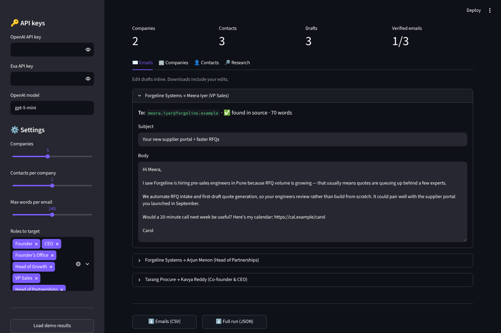

# 📬 GTM Outreach Agent

An AI agent for B2B outbound. It finds companies that fit your offering, researches each one, identifies decision makers, and drafts a personal email for each contact. Every claim it makes is grounded in a real source.




## Why it's built this way

LLM outreach tools often invent things: companies that don't exist, "insights" with no source, and guessed email addresses presented as real. This agent is **retrieval-first**. It searches the web, the model reasons *only* over what was retrieved, and code then checks the output against the sources:

| Check | What happens |
|---|---|
| **Companies are grounded** | A company is kept only if its domain appeared in the search results. Invented ones are dropped. |
| **Insights are cited** | Each insight must cite a URL that was actually retrieved; anything else is discarded. Every insight in the UI links to its source. |
| **Emails are labelled honestly** | ✅ *found*: the exact address appears in a source. 🟡 *pattern*: built from the company's email format, so verify it before sending. ⚪ *unknown*. If the model claims an address was "found" but it isn't in any source, it's downgraded to *pattern*. |
| **Drafts are linted** | Drafts that run over the word limit or contain leftover placeholders like `[Name]` are flagged. |
| **Structured outputs** | Every LLM call returns a Pydantic-validated object, so there's no fragile JSON parsing. |

## How it works

```
             ┌────────────────────────────┐
 target  ──► │ 1. Find companies          │  Exa company search → LLM shortlists + scores fit (1-10)
 offering    └─────────────┬──────────────┘
                           │  for each company, in parallel
         ┌─────────────────┼─────────────────┐
         ▼                 ▼                 ▼
 ┌──────────────┐  ┌──────────────┐  ┌──────────────┐
 │ 2. Research  │  │ 3. Contacts  │  │ 4. Draft     │
 │ site + news  │─►│ people search│─►│ one email    │
 │ + Reddit     │  │ email format │  │ per contact  │
 └──────────────┘  └──────────────┘  └──────────────┘
                           │
                           ▼
          Review & edit in the UI  →  export CSV / JSON
```

Companies are processed concurrently, and each one is isolated: if research fails for one company (a rate limit, say), its contacts and drafts still go ahead and the error is shown beside it.

## Features

- **4 email styles:** Professional, Casual, Cold and Consultative, with an adjustable word limit
- **Configurable targeting:** number of companies, contacts per company, and which roles to prioritise
- **Editable drafts:** tweak subject and body inline, and the exports include your edits
- **Exports:** a CSV with one row per draft, ready for mail-merge or CRM import, plus the full run as JSON
- **Demo mode:** explore the whole UI with fictional sample data, no API keys needed
- **CLI:** run headless for scripting or batch jobs
- **Human in the loop:** nothing is ever sent automatically

## Getting started

```bash
git clone https://github.com/CarolDsillva/Email_gtm_outreach_agent.git
cd Email_gtm_outreach_agent
pip install -r requirements.txt
streamlit run app.py
```

Enter your [OpenAI](https://platform.openai.com/api-keys) and [Exa](https://dashboard.exa.ai/) keys in the sidebar, or copy `.env.example` to `.env`. To look around first, click **Load demo results**.

### Command line

```bash
python -m gtm_agent \
  --target "B2B SaaS companies in India, 50-500 employees, serving manufacturers" \
  --offering "AI automation for RFQ processing and quote generation" \
  -n 3 --style Consultative --sender-name Carol --sender-company "Acme AI" \
  -o output/run          # writes output/run.json and output/run.csv
```

Run `python -m gtm_agent --help` to see every option. The model defaults to `gpt-5-mini`; change it with `--model` or the `OPENAI_MODEL` variable.

## Project structure

```
├── app.py                 # Streamlit UI
├── gtm_agent/
│   ├── pipeline.py        # stages, grounding checks, parallel orchestration
│   ├── clients.py         # Exa search + OpenAI structured-output adapters
│   ├── schemas.py         # Pydantic models for LLM outputs and results
│   ├── export.py          # CSV / JSON export
│   ├── demo.py            # fictional sample run for demo mode
│   └── __main__.py        # CLI
└── tests/
    └── test_pipeline.py   # offline tests with fake search + LLM clients
```

The pipeline depends only on two small interfaces, `SearchClient` and `LLMClient`. That makes it testable without network access, and lets you swap in another search or model provider without touching the pipeline logic.

## Tests

```bash
pip install -r requirements-dev.txt
pytest
```

The tests use fake search and LLM clients. They cover the grounding checks (invented companies dropped, uncited insights removed, "found" emails downgraded), deduplication, per-company failure isolation, and the exports.

## Responsible use

This tool drafts emails; it never sends them. Verify 🟡 inferred addresses before you use them, keep outreach relevant and low-volume, and follow the email-marketing rules that apply to you (CAN-SPAM, GDPR and so on), including a clear way for recipients to opt out.

## License

[MIT](LICENSE) © Carol Dsilva
